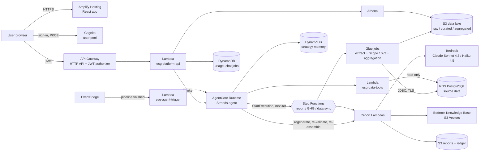
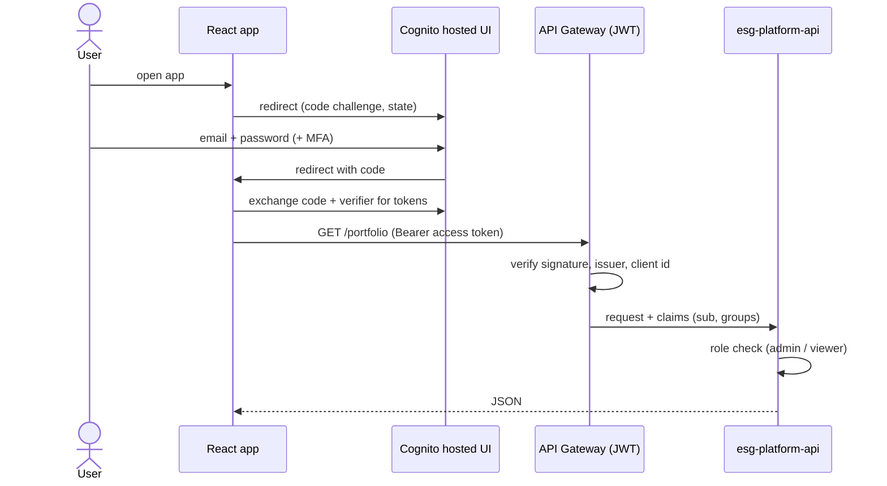
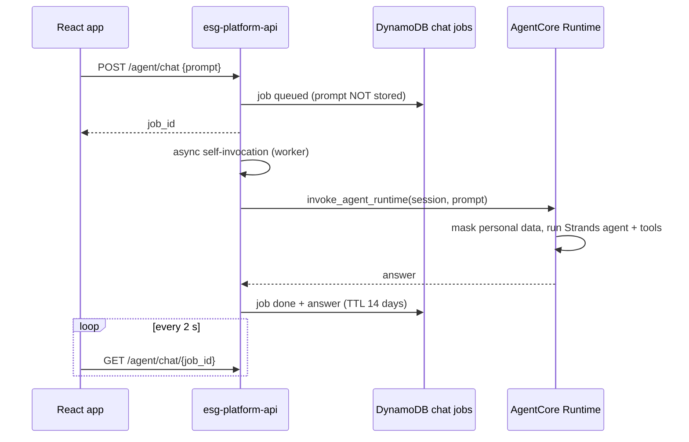
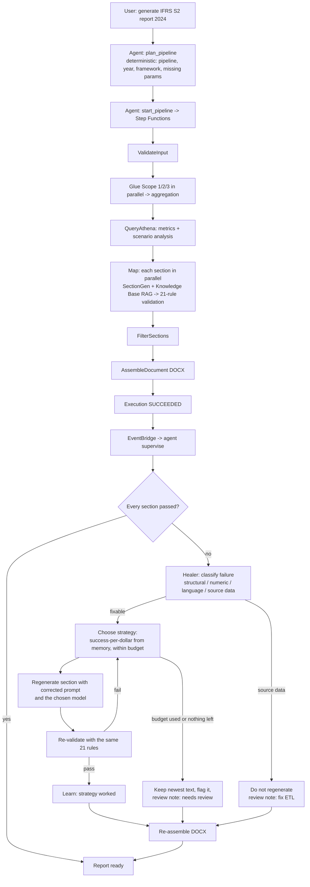
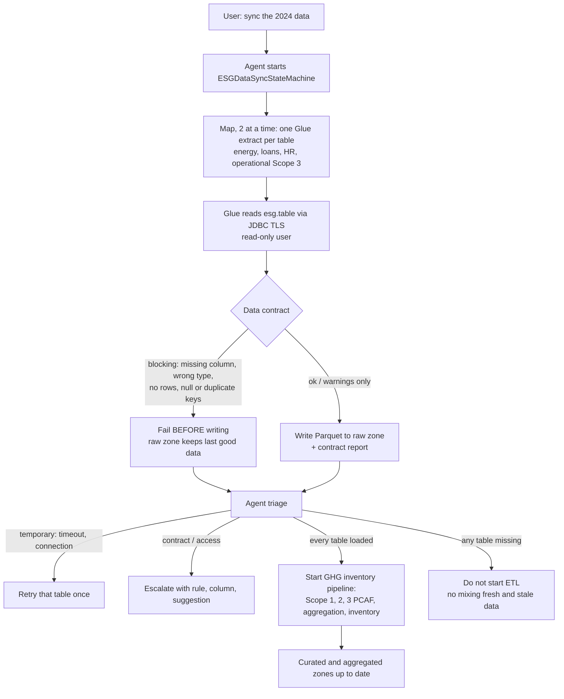

# ESG Intelligence Platform: architecture and flows

Source document for presentations and for drawing the architecture diagram. It describes the system as deployed on
`main-agentcore` (account `061039769766`, `us-east-1`). Diagrams are in Mermaid; GitHub renders them, and draw.io can
import them (*Arrange > Insert > Advanced > Mermaid*). Section 12 proposes a slide outline.

---

## 1. What the platform does

A bank has to publish sustainability disclosures under several frameworks at once, with numbers that must be traceable
to source data. The platform turns that into four capabilities, all on one dataset:

| # | Capability | What the user sees | Main AWS services |
|---|---|---|---|
| 1 | **Compliance Intelligence** | PSPK 1 & 2 readiness score with gaps per pillar and the system that should supply each missing item; daily regulatory change scan classified by AI | Lambda, Athena, Bedrock (Haiku), EventBridge |
| 2 | **Multi-framework reports + scenarios** | One request produces GRI 305, IFRS S2, CSRD ESRS E1 or OJK PSPK reports (or all at once) as DOCX; 1.5°C / 2°C / 3°C+ scenarios with what-if sliders | AgentCore, Step Functions, Lambda, Bedrock (Sonnet/Haiku), Knowledge Base |
| 3 | **Data quality and portfolio** | PCAF data-quality score per asset class, TKBI-style green / transition / brown split, green-ratio path to 2030, peer benchmark | Athena, Lambda |
| 4 | **AI governance and FinOps** | Personal data masked before any model sees it (UU PDP); every model call metered; cost by model, task and subsidiary; routing profiles compared | Lambda, Bedrock Guardrails, DynamoDB |
| + | **GHG inventory** | Inventory in the GHG Protocol Scope 3 template structure (Parts 1-6) | Glue, Step Functions, Athena |
| + | **AI assistant** | Natural-language requests: "sync the 2024 data", "generate an IFRS S2 report", "why did this section fail?" | AgentCore Runtime |

Users sign in with Amazon Cognito. Roles: `admin` (can run regulatory scans and attest checklist items) and `viewer`.

---

## 2. Architecture in one picture

The key idea: **AgentCore is the outer orchestrator, Step Functions is the inner execution engine.**
Step Functions runs the heavy, durable, parallel work (Glue ETL, parallel section generation, assembly). The agent decides
what to run, watches it, repairs what failed validation, triages data problems and explains the result in plain language.

---

## 3. Layers

| Layer | Components | Notes |
|---|---|---|
| Presentation | React 18 + Vite + Tailwind + Recharts on Amplify Hosting | Live mode reads the API; demo mode uses bundled data |
| Identity | Cognito user pool, hosted UI, authorization code + PKCE | Admin-created users only, groups `admin` / `viewer`, optional TOTP MFA |
| API | API Gateway HTTP API, JWT authorizer, one Lambda router (`esg-platform-api`) | 30 req/s, burst 60; long operations are asynchronous |
| Agent | Bedrock AgentCore Runtime (Python 3.12, arm64, zip package), Strands Agents SDK | 15 tools; deterministic planner and supervisor around the LLM |
| Orchestration | Step Functions: `ESGReportGenerationStateMachine`, `ESGGhgInventoryStateMachine`, `ESGDataSyncStateMachine` | EventBridge hands finished report runs to the agent |
| Generation | 6 report Lambdas, Bedrock Claude Sonnet 4.5 and Haiku 4.5, Knowledge Base (Titan V2 embeddings, S3 Vectors) | Model chosen per task by the routing profile |
| Data | RDS PostgreSQL 16 (source) -> Glue -> S3 raw / curated / aggregated -> Athena | Hive-style partitions, partition projection |
| Governance | Bedrock Guardrail (PII), HMAC pseudonymisation (Secrets Manager key), usage metering (DynamoDB) | Prompts are never stored |
| Network | VPC with isolated subnets only, S3 gateway endpoint, Secrets Manager interface endpoint | Database not reachable from the internet |

---

## 4. Infrastructure as code: the five CDK stacks

| Stack | Creates | Depends on |
|---|---|---|
| `EsgFoundationStack` | 6 S3 buckets, Athena workgroup, 4 Glue ETL jobs, 6 report Lambdas + python-docx layer, report state machine, 2 SNS topics, PII secret, Knowledge Base on S3 Vectors | - |
| `EsgNetworkStack` | VPC (2 isolated subnets), S3 gateway endpoint, Secrets Manager endpoint, security groups | - |
| `EsgDatabaseStack` | RDS PostgreSQL 16 `esg-source-db`, master and read-only secrets | Network |
| `EsgDataStack` | Glue connection + extract job `esg-extract-rds`, data sync state machine, Lambdas `esg-rds-seed` and `esg-data-tools` in the VPC | Network, Database, Foundation buckets |
| `EsgPlatformStack` | Cognito, HTTP API, `esg-platform-api`, `esg-agent-trigger`, AgentCore runtime, GHG state machine, DynamoDB (usage, chat jobs, strategy memory), guardrail, EventBridge rules, dead-letter queue | Foundation (KB id, secret), Data (sync state machine, data tools) |

Outside CDK: the Amplify app (connected to GitHub in the console), Bedrock model access, Cognito users, Glue/Athena
tables (`scripts/apply_ddl.py`) and Knowledge Base documents (`scripts/upload_kb_documents.py`).

---

## 5. Flows

### 5.1 Sign-in and an API call

Tokens live in `sessionStorage` (closing the tab signs out) and refresh silently. No client secret exists in the browser.

### 5.2 A chat turn

Why asynchronous: API Gateway cuts requests at 30 seconds and an agent turn can take longer. Only the owner (or an admin)
can read a job. The conversation and the AgentCore session id are kept in the browser (per user, until the tab closes),
so changing pages does not lose the chat; a turn that is still running is picked up again on return. "New chat" starts a
new session. Every turn's tokens are metered (task `agent_chat`, with the user) for the FinOps page.

### 5.3 Report generation with adaptive self-correction

Report sections per framework: GRI 305 (7), IFRS S2 (8), CSRD E1 (9), OJK PSPK (8), multi-framework (10 unified,
including a climate-scenario section).

### 5.4 Data sync from the source database

### 5.5 Other flows
- **GHG inventory.** Step Functions runs the three scope jobs in parallel, then aggregation, then the platform Lambda
  builds the GHG Protocol template (Parts 1-6) and stores it in S3. Missing operational Scope 3 data is reported as
  "not measured", never as zero.
- **Regulatory scan.** EventBridge triggers the platform Lambda daily (01:00 UTC). It reads an allow-list of regulator
  pages, keeps items matching sustainability keywords, de-duplicates them, and Haiku classifies severity, affected
  report sections and the suggested action. Admins can start a scan from the UI.
- **Compliance readiness.** Each checklist item has a probe: rows exist in Athena, PCAF quality threshold, assurance
  level, a recent scenario run, or a manual attestation by an admin. The score is weighted by disclosure criticality.
  A probe that cannot run (technical error) makes the item "Not checked": it is shown but left out of the score, so a
  broken query never looks like a compliance gap.
- **Scenario what-if.** A transparent screening model on the loan book: transition loss from a carbon price per sector,
  physical loss on property collateral in flood zones, green-loan opportunity. Sliders re-run it through the API.

---

## 6. The agent in detail

### 6.1 Tools (15)
| Group | Tools |
|---|---|
| Pipelines | `plan_pipeline`, `list_capabilities`, `start_pipeline`, `get_run_status`, `supervise_run`, `explain_run`, `get_download_link` |
| Platform | `get_compliance_readiness`, `get_regulatory_alerts`, `get_ghg_inventory`, `run_climate_scenarios`, `get_ai_cost_summary` |
| Source data | `sync_data_from_database`, `inspect_source_database`, `get_etl_report` |

### 6.2 Where the LLM decides and where code decides
| Decision | Made by | Why |
|---|---|---|
| Understanding the request, asking for missing parameters, explaining results | LLM (agent) | Language |
| Mapping a request to a pipeline and parameters | Deterministic planner, called as a tool | Reproducible, testable, never guesses a year |
| Whether a section passed | 21-rule validator (code) | The judge must not be the model that wrote the text |
| Which repair strategy and model to try next | Adaptive policy (code + learned statistics) | Bounded cost, explainable choices |
| Correction hint for hard cases | LLM ("critic" strategy), sanitised | Only one of six strategies |
| Data-sync triage, retry, whether to run the ETL | Code in the agent | Safety rules, no mixing of stale and fresh data |

### 6.3 Adaptive self-correction
| Strategy | Model | Change to the regeneration prompt |
|---|---|---|
| `fix_cheap` | Haiku 4.5 | Corrective instructions for the failed rules |
| `fix_strong` | Sonnet 4.5 | Same, stronger model |
| `grounded_cheap` / `grounded_strong` | Haiku / Sonnet | Adds the list of numbers allowed (taken from the source metrics) |
| `critic_strong` | Haiku writes a hint, Sonnet regenerates | Adds an AI-written, sanitised hint |
| `minimal_safe` | Sonnet | Short text, figures only in tables; always the last resort |

Order = expected success per dollar. Each attempt updates a success counter per *failure type x strategy* in DynamoDB, so
cheap models are tried first only while they keep working. Stops when the section passes, only source-data problems
remain, every strategy was tried, or the budget is reached (USD 0.40 per section, USD 1.50 per run, at most 4 attempts).
Unresolved sections stay in the report, flagged, with a plain-language review note. There is no approval gate yet.

### 6.4 Run ledger and checkpoints
Every decision is an event in `s3://esg-output-reports-<acct>/agent-ledger/<execution>.json`: started, reviewed,
regenerating (strategy, model, expected success, cost), re-validated, re-assembled, escalated. A lock object prevents
two supervisors from working on one run.

`GET /agent/runs/{id}/progress` merges the Step Functions execution history (inner steps, with per-item counts of the
Map states such as "5/8 sections" or "3/4 tables") with the ledger (the agent's own steps: review, repair, re-assemble,
triage, ETL). The UI shows this as a live checkpoint list in the chat (right after the agent starts a run), in the Agent
activity panel and on Report Runs. Each run has a one-line summary in its pipeline's terms
("4/4 tables loaded · ETL finished", "2 section(s) repaired · 1 need review"), and the ETL a data sync starts is shown
under it as a child run. Review notes carry their own label (Loaded, Repaired, Needs review, Source data problem).

---

## 7. Data

### 7.1 Source database (PostgreSQL schema `esg`)
| Table | Rows (2023 + 2024) | Key |
|---|---|---|
| `energy_consumption` | 5,280 (220 facilities x 12 months x 2 years) | year, month, facility |
| `loan_portfolio` | 4,400 | year, loan |
| `hr_metrics` | 2 (aggregate, no personal data) | year |
| `scope3_operational_activity` | 16 (categories 1-7) | year, category, activity |

### 7.2 Data lake
| Zone (bucket) | Tables | Written by |
|---|---|---|
| Raw `esg-data-raw-<acct>` | the four source tables | Glue extract |
| Curated `esg-data-curated-<acct>` | `ghg_scope1`, `ghg_scope2`, `ghg_scope3_financed` | Glue scope jobs |
| Aggregated `esg-data-aggregated-<acct>` | `ghg_summary_annual`, `pcaf_by_sector`, `scope1_by_facility` | Glue aggregation |
The platform reads the aggregated zone (and the raw loan book for portfolio analytics) through Athena.

### 7.3 Other stores
| Store | Content | Retention |
|---|---|---|
| `esg-output-reports-<acct>` | reports (DOCX/PPTX), sections, ledger, execution metadata, contract reports, caches | reports kept; operational prefixes 14 days |
| `esg-kb-documents-<acct>` | `documents/` (indexed), `prompts/`, `prompts/templates/` | kept |
| Knowledge Base | 14 documents (GRI, IFRS S2, ESRS E1, POJK 51, GHG Protocol, PCAF, IPCC AR6, 5 sample bank reports) | kept |
| DynamoDB usage | one item per model call: tokens, cost, all-Sonnet baseline, execution | 14 days |
| DynamoDB chat jobs | answer per chat turn (no prompt) | 14 days |
| DynamoDB strategy memory | trials and successes per failure type x strategy | kept |

---

## 8. Security

| Area | Control |
|---|---|
| Identity | Cognito, no self-sign-up, 12+ character passwords, optional MFA, PKCE (no secret in the browser) |
| Authorisation | JWT authorizer on every route except `/health`; group-based roles in the Lambda; admin-only scan and attestation; client-supplied internal fields are dropped |
| Personal data | Regex + roster masking before any model call (chat prompts, report metrics), stable HMAC pseudonyms (key in Secrets Manager), Bedrock Guardrail as a second check in the masking service, chat prompts never stored |
| Network | Database in isolated subnets, no NAT, TLS required, reachable only from the Glue and tool security groups |
| Least privilege | Bedrock limited to the Claude 4.5 models and Titan V2; S3 writes scoped to the buckets each component owns; read-only database user for Glue and the agent; master credentials only in the seed Lambda |
| Data integrity | Data contracts block broken loads before they overwrite good data; every figure in a report is validated against the source metrics |
| Encryption | S3 SSE, RDS storage encryption, TLS in transit |
| Headers | HSTS, nosniff, frame deny, referrer policy (Amplify); `no-store` on API responses |

---

## 9. Operations, observability and cost

- **Observability.** CloudWatch Logs (14 days) for every Lambda, Glue job and the runtime; X-Ray tracing on Lambdas;
  OpenTelemetry instrumentation in the agent runtime. No alarms or dashboards (decision for this phase).
- **Cost tracking.** Every Bedrock call is metered with its cost and the all-Sonnet baseline; the Governance page shows
  spend by day, model, task and subsidiary and what other routing profiles would have cost.
- **Cost profile.** Always on: RDS db.t4g.small and the Secrets Manager endpoint (about USD 40 a month together,
  estimate). Pay per use: Bedrock tokens (largest variable cost), Glue DPU-minutes per sync or report, Lambda, Athena
  scans, S3 Vectors queries. The Knowledge Base uses S3 Vectors instead of OpenSearch Serverless to avoid a fixed
  monthly floor.
- **Delivery.** CDK for all infrastructure; GitHub Actions runs tests, builds artifacts and synthesises the stacks;
  Amplify rebuilds the frontend on every push to `main-agentcore`.

---

## 10. Design decisions

| Decision | Alternatives considered | Reason |
|---|---|---|
| AgentCore as outer orchestrator, Step Functions as inner engine | Agent does everything; Step Functions only | Agent adds judgement and explanation; Step Functions keeps heavy work durable, parallel and auditable |
| Deterministic planner and validator around the LLM | Let the agent decide everything | Reproducible routing, the judge is independent of the writer, unit-testable |
| Adaptive repair with budgets and learned statistics | Fixed retry count | Cheaper fixes first, stops on cost, gets better with use |
| Multi-model routing (Haiku / Sonnet) per task | Sonnet everywhere | Large cost reduction on simple tasks; quality kept for narrative and corrections |
| Data contracts before the write | Validate after loading | A broken source never overwrites the last good data |
| Knowledge Base on S3 Vectors | OpenSearch Serverless | No fixed monthly minimum |
| Agent packaged as a zip | Container image | No Docker needed to deploy; container remains an option |
| Asynchronous chat and scans with polling | Long HTTP requests | API Gateway 30-second limit; allows JWT protection everywhere |
| Single production environment | Staging + production | New product; CDK keeps it reproducible |
| Synthetic data treated as real | Real bank data | Demo safety; same pipelines would run on real data |

---

## 11. Limits and next steps

- Not built yet: connectors to real source systems beyond the PostgreSQL source (core banking, HR, utilities),
  human approval before publishing, AgentCore Gateway and Memory (strategy memory uses DynamoDB today).
- Illustrative content: peer scores, the regulatory source list, the TKBI split per sector, scenario parameters.
- Not yet verified against live runs at the time of writing: the full first data load and first report through the
  adaptive loop (see DEPLOY_PLATFORM.md section 10).

---

## 12. Suggested slide outline

1. **The problem.** Several frameworks, one deadline, numbers that must be traceable (section 1).
2. **The platform in one picture** (section 2 diagram).
3. **Four capabilities** with one screenshot each (section 1 table).
4. **Agentic orchestration.** Outer agent, inner Step Functions; where the LLM decides and where code decides (6.2).
5. **Report generation and self-correction** (5.3 diagram, 6.3 table): validated numbers, adaptive repair, review notes.
6. **From database to report** (5.4 diagram): data contracts, triage, no stale data.
7. **Responsible AI.** PII masking, guardrail, role-based access, metering (section 8, Governance page).
8. **Token FinOps.** Routing profiles and measured savings (section 9, Governance page).
9. **Built on AWS.** The five stacks and services (sections 3 and 4).
10. **Design decisions** (section 10) and **next steps** (section 11).

---

## Glossary

| Term | Meaning |
|---|---|
| PSPK | Indonesian sustainability disclosure standards (PSPK 1 general, PSPK 2 climate), based on IFRS S1/S2 |
| PCAF | Partnership for Carbon Accounting Financials: method for financed emissions, data-quality score 1 (best) to 5 |
| TKBI | Taksonomi untuk Keuangan Berkelanjutan Indonesia (Indonesian sustainable finance taxonomy) |
| Scope 1 / 2 / 3 | Direct emissions / purchased energy / value chain (category 15 = financed emissions) |
| AgentCore Runtime | Managed runtime for AI agents in Amazon Bedrock |
| Strands Agents | Open-source agent SDK used inside the runtime |
| Data contract | Rules a source table must meet (columns, types, ranges, keys) before it enters the data lake |
| Ledger | The per-run timeline of agent decisions |
